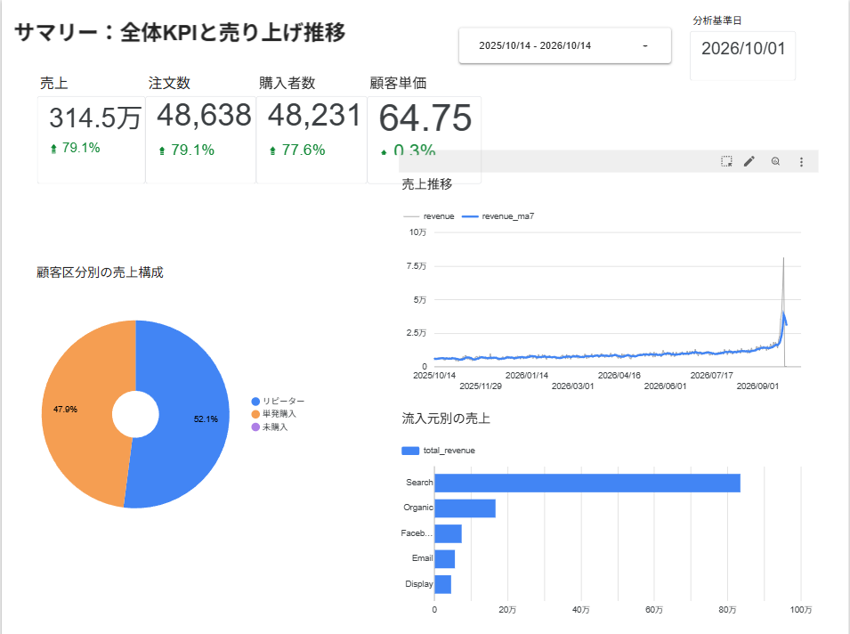
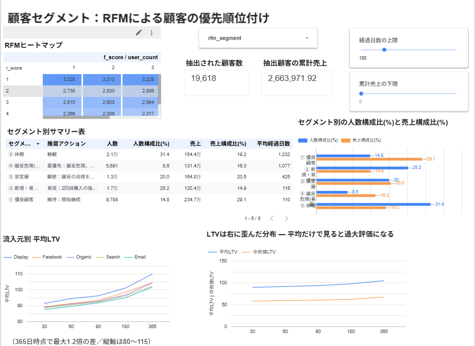
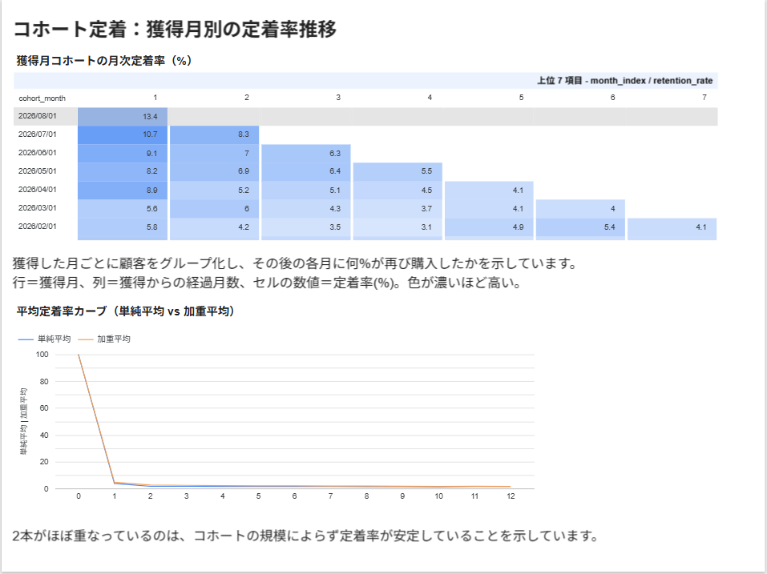
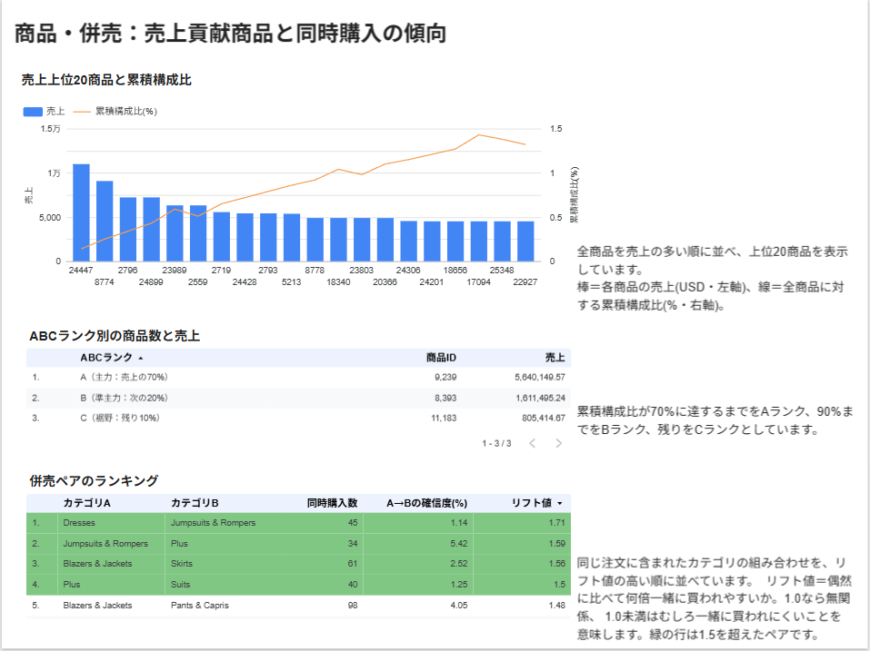
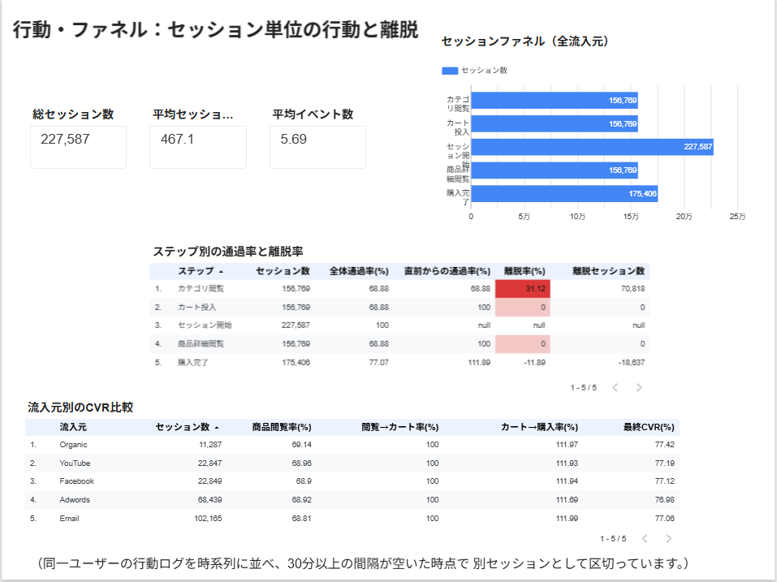

# EC購買データ 顧客分析ダッシュボード

BigQueryとLooker Studioを用いて、ECサイトの購買データ・行動ログから顧客セグメント・定着率・LTV(顧客生涯価値)・併売・行動ファネルを分析し、施策判断に使えるダッシュボードとして構築したものです。

分析結果を提示するだけでなく、**閲覧者が自分で条件を変えて検討できる状態**を目標としています。

---
## リポジトリ構成

```
ec-customer-analytics/
├── README.md
├── docs/
│   ├── data_dictionary.md      # テーブル・列の定義、粒度、結合の前提
│   ├── metrics_definition.md   # 指標の計算式と判断基準
│   └── images/                 # ダッシュボードのスクリーンショット
└── sql/
    ├── README.md               # 実行順序・依存関係図・命名規則
    ├── 01_staging/             # 公開データから作業用テーブルを作る
    ├── 02_mart/                # 分析単位ごとの集計テーブル
    └── 03_views/               # ダッシュボードが参照するビュー
```

各SQLファイルの冒頭には、粒度・依存関係・**その設計にした理由**をコメントで記載しています。

---

## ダッシュボード

**<https://datastudio.google.com/reporting/f170856e-63cd-4a74-b5cf-263da6b261b3/page/mHiAG>**

| ページ | 内容 |
|---|---|
| ① サマリー | 全体KPIと売上推移 |
| ② 顧客セグメント | RFMによる顧客の優先順位付け |
| ③ コホート定着 | 獲得月別の定着率推移 |
| ④ 商品・併売 | 売上貢献商品と同時購入の傾向 |
| ⑤ 行動・ファネル | セッション単位の行動と離脱箇所 |







---

## 使用技術

| 分類 | 内容 |
|---|---|
| データウェアハウス | Google BigQuery |
| クエリ | BigQuery 標準SQL |
| BI | Looker Studio |

---

## データセット

`bigquery-public-data.thelook_ecommerce`（Google提供の公開EC擬似データ）

| テーブル | 行数 |
|---|---|
| `events`（Web行動ログ） | 2,425,353 |
| `inventory_items` | 488,014 |
| `order_items`（注文明細） | 180,858 |
| `orders` | 124,581 |
| `users` | 100,000 |
| `products` | 29,120 |

**期間**：2019年1月 〜 2026年9月（約2,800日）

**分析対象**：キャンセル（14.9%）・返品（10.0%）を除外した135,619明細、
売上合計 約806万ドル、購入者66,023人。

購買データを選んだ理由は、**ウィンドウ関数・自己結合・ログのセッション化といった単純集計を超えたSQLが、分析の必然として一通り登場する**と考えたからです。  
アンケートや単票の時系列データでは、これらの技法を使う場面が自然には発生しません。

---

## データ品質の確認結果

分析に入る前に以下を確認しています。

| 観点 | 対象 | 結果 |
|---|---|---|
| 主キーの重複 | users / order_items / products | 0件 |
| NULL の混入 | order_items の主要6列 | 0件 |
| 参照整合性 | order_items → users / products | 孤児レコード0件 |
| 金額の異常値 | sale_price | マイナス0件、ゼロ円0件、範囲 $0.02〜$999 |
| 時系列の連続性 | 日次注文 | 2,821日中54日が注文ゼロ（補完対象） |

参照整合性が担保されていることを確認したうえで、商品マスタ・顧客マスタとの結合は
`INNER JOIN` を採用しています。

---

## 分析内容

| 分析 | 目的 | 使用した主なSQL技法 |
|---|---|---|
| RFM分析 | 顧客の優先順位付け | `NTILE`, 3つの軸のスコアリング |
| コホート分析 | 獲得月別の定着率比較 | `GENERATE_ARRAY`, `CROSS JOIN UNNEST`, `LEFT JOIN` による欠損補完 |
| LTV分析 | 投資可能な獲得コストの算出 | `SUM() OVER (ROWS BETWEEN UNBOUNDED PRECEDING AND CURRENT ROW)`, `APPROX_QUANTILES` |
| バスケット分析 | 併売傾向の検証 | 自己結合（`a.key < b.key`）, support / confidence / lift |
| ABC分析 | 商品の重要度分類 | 累積ウィンドウ関数, `ROW_NUMBER` |
| ファネル分析 | 離脱箇所の特定 | `COUNTIF`, `FIRST_VALUE`, `LAG`, `UNION ALL` による縦持ち変換 |
| セッション化 | 行動ログの区切り | gaps-and-islands 法（`LAG` → フラグ → `SUM() OVER` の累積和） |

---

## 主な分析結果

### 1. 購入者の69%が1回だけ購入

| 顧客区分 | 人数 | 平均売上 | 平均注文数 |
|---|---|---|---|
| 単発購入 | 45,663 | $85.1 | 1.0 |
| リピーター | 20,360 | $204.87 | 2.37 |
| 未購入 | 33,977 | $0 | 0 |

購入経験のある顧客 66,023 人のうち、**69%が1回限りの購入**です。
リピーターは1人あたり単発購入者の2.4倍の売上をもたらしており、
2回目の購入に到達させることの価値がそのまま数字に表れています。

### 2. 離反危険層が最も重要

| セグメント | 人数 | 人数構成比 | 売上構成比 | 平均売上 | 平均経過日数 |
|---|---|---|---|---|---|
| ① 優良顧客 | 9,788 | 14.8% | **29.1%** | $240 | 110日 |
| ② 新規・育成中 | 16,620 | 25.2% | 14.9% | $72 | 115日 |
| ③ 安定層 | 13,205 | 20.0% | 20.5% | $125 | 425日 |
| ④ 離反危険 | 5,691 | 8.6% | **16.3%** | $231 | **1,077日** |
| ⑤ 休眠 | 20,719 | 31.4% | 19.2% | $75 | 1,232日 |

優良顧客は人数の14.8%で売上の29.1%を占めます。

ここで重要なのが④離反危険層です。人数では8.6%にすぎませんが売上では16.3%を占め、1人あたり売上$231は優良顧客の$240に迫ります。過去に高額を使っていた顧客が**平均1,077日（約3年）購買していない**状態です。再接触の優先度が最も高い層と判断しました。

ダッシュボードではこのセグメントに「最優先：離反危険。再接触」という推奨アクションを
列として持たせています。

### 3. 定着率は1ヶ月目で急落

獲得月コホートの定着率は1ヶ月目に一桁台まで落ち、2ヶ月目以降はほぼ横ばいで推移します。
獲得月を変えても曲線の形はほぼ同一でした。

改善余地は初回購入後30日間に集中しており、それ以降の施策の期待値は低いと考えます。
さきほどの単発購入比率69%とも整合する結果です。

### 4. 流入元によるLTVの差は小さい

365日時点の平均LTVは、流入元間で最大1.2倍程度の差にとどまりました。
チャネルの選定よりも、獲得単価の管理のほうが投資効率への影響が大きいと言えます。(顧客セグメント「流入元別LTVカーブ」)  

一方、LTVの分布は大きく右に歪んでいます。全体の平均LTVは中央値の約1.6倍でした。（顧客セグメント「平均LTV vs 中央値LTV」）  
同じ傾向は商品単価にも表れており、平均 $59.42 に対して中央値$39.99、上位1%は$300でした。平均値のみで顧客価値を見積もると過大評価になるため、ダッシュボードでは中央値を必ず併記しています。

### 5. 商品単位の売上は極端に分散している

| ランク | 商品数 | 商品数構成比 | 売上構成比 |
|---|---|---|---|
| A（主力） | 9,239 | 32.1% | 70.0% |
| B（準主力） | 8,393 | 29.1% | 20.0% |
| C（裾野） | 11,183 | 38.8% | 10.0% |

売上の70%を生み出すのに、**商品数の32%を要しました**。

### 6. カテゴリ間の併売傾向はほとんど見られない

カテゴリのペア238件のリフト値（2つの商品が、偶然に比べて何倍一緒に買われやすいかを表す指標）は、**中央値0.62、第3四分位でも0.75**であり、4分の3以上のペアが1を下回りました。「偶然より一緒に買われにくい」という状態です。1.5を超えたのは4ペアのみでした。  

最もリフト値が低いのはSkirts × Sleep & Lounge（0.369）、Blazers & Jackets × Tops & Tees（0.392）など、いずれも日常的に併売されそうな組み合わせでした。
**併売施策の余地は限定的**というのが、このデータからわかります。

### 7. 自作セッションは既存定義の1.26倍に分割された

30分無操作で区切る自前の定義と、元データの `session_id` を照合しました。

| 比較項目 | 結果 |
|---|---|
| 既存の session_id 数 | 180,778 |
| 自作セッション数 | 227,587（**125.9%**） |
| 既存セッションと1対1で一致 | 106,932（59.2%） |
| 2つに分割された | 73,846（40.8%） |

既存定義の約6割はそのまま一致し、約4割は本定義のほうが細かく分割されました。
**3つ以上に分割されたケースは発生していません。**

元データの `session_id` がどの基準で付与されたかは公開されていませんが、
30分より長い無操作を許容する定義になっていると推測されます。

---

## 設計方針

**1. 分析の基準日をビューで一元管理**

`v_config` に `LEAST(データ最大日, 実行日-1)` を定義し、全てのクエリがこれを参照します。
データに未来日付や当日の部分データが含まれる場合でも、集計結果が実行タイミングに左右されません。

**2. 観測期間が不足した対象を除外**

コホート分析・LTV分析のいずれも「nヶ月／n日が経過済みの対象のみ」という条件を実装しています。この条件がないと、直近に獲得した顧客ほど成績が悪く見え、施策の効果と観測期間の不足が区別できなくなります。

**3. 行の欠落と0を区別**

活動がゼロだった月は元テーブルに行が存在しないため、`GENERATE_ARRAY` で
マス目を生成して `LEFT JOIN`し、0%として明示的に補完しています。
補完しない場合、その月が平均の分母から消えて定着率が過大に算出されます。
一方、まだ到来していない月は行そのものを生成せず、0 とは区別しています。

売上の日次集計でも同様に、`GENERATE_DATE_ARRAY` で全日付を生成しています。
対象期間 2,821日のうち54日は注文がなく、補完しないと移動平均と前年同日比の窓が
日数ではなく行数でずれます。

**4. セッションを自前で定義し、既存定義と照合**

30分無操作で区切る gaps-and-islands 法で実装し、元データの `session_id` と
突き合わせて検証しました（結果は「主な分析結果 7」）。
実務ではセッション定義がログに含まれない、あるいは要件と合わないことが多いため、
自分で定義し妥当性を確認できる形を採用しています。

なお全イベントの46%は未ログイン（`user_id` が NULL）であり、ユーザーを特定できず
時系列で繋げられないため除外しています。ファネル分析は
**ログイン済みユーザーの行動に限定**した結果である点を明記しています。

**5. 平均と中央値を併記**

LTV・単価は分布が右に歪むため、平均値だけでは実態を過大評価します。
中央値を併記し、ダッシュボード上でも乖離が見える形にしています。

**6. 分布を確認したうえでスコアの解釈を限定する**

RFMスコアは `NTILE(5)` による5分位で付与しています。絶対値の閾値を決め打ちしないのは、
データの増減でセグメントの人数が偏らないようにするためです。

ただし、F軸（購買頻度）については分布を確認した結果、**スコア1〜3がすべて
「購入回数1回」の顧客**で構成されていました。購入者の69%が1回限りであるため、
同じ値を機械的に5分割している状態で、F軸単独では顧客を識別できていません。

| Fスコア | 人数 | 購入回数の範囲 |
|---|---|---|
| 1 | 13,205 | 1回 |
| 2 | 13,205 | 1回 |
| 3 | 13,205 | 1回 |
| 4 | 13,204 | 1〜2回 |
| 5 | 13,204 | 2〜4回 |

この性質を踏まえ、セグメント判定は **R軸（離反の兆候）を主軸**に置き、
F軸とM軸は平均値（fm_score）として従属的に使う設計にしています。
R軸は経過日数3日〜2,816日の範囲を明確に5分割できており、識別力があります。

---

## 今後の課題

**1. 購入前の行動の大半を分析できていない**

ファネル分析は、ユーザーを特定できる必要があるためログイン済みのイベントに限定しています。
除外した未ログインイベントは全体の46%にあたり、「初回訪問から会員登録までの導線」は現在の構成では一切見えていません。
CookieやデバイスIDによる仮IDを用いてセッションを連結し、登録前後の行動を繋げる設計が次の課題です。

**2. データ品質チェックが一度きり**

主キーの重複・NULL・参照整合性は構築時に確認しましたが、その後のデータ更新で壊れても気づけません。件数の急減、NULL率の上昇、金額の異常値といったチェックをクエリとして定義し、実行のたびに自動で検証する仕組みが必要と考えます。

**3. 予測を扱っていない**

本成果物は実績の可視化に限定しており、将来の予測は含めていません。
BigQuery ML を用いた売上予測や再購買確率のスコアリングを加えることで、「離反しそうな顧客を事前に検出する」といった使い方が可能になります。
